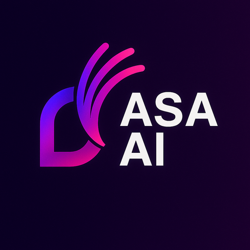
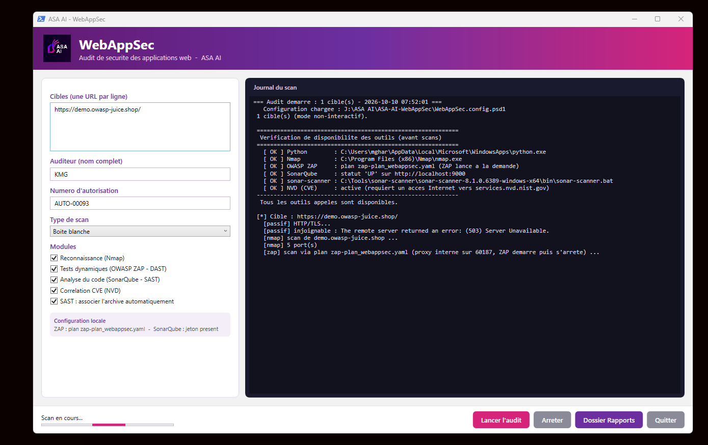
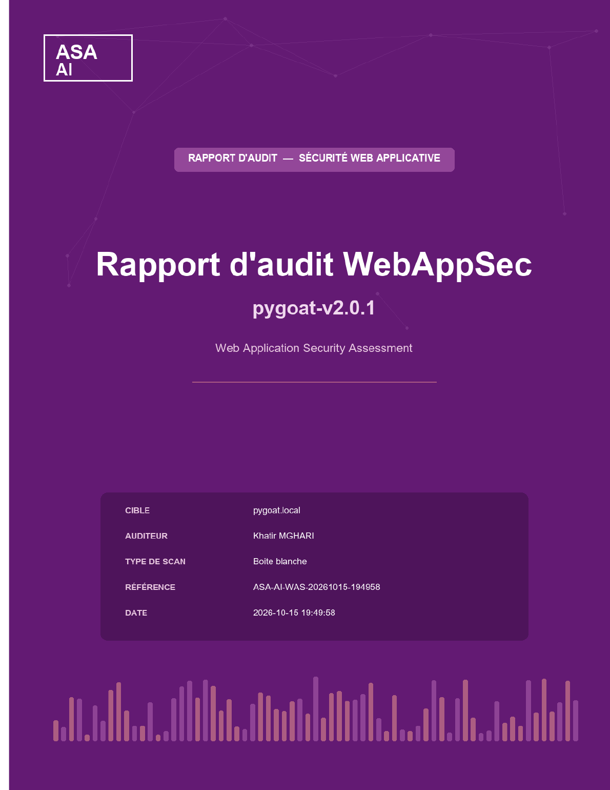

# ASA AI — WebAppSec

**Web Application Security Assessment · Audit de sécurité des applications web**

Passive recon · Nmap · OWASP ZAP (DAST) · SonarQube (SAST) · CVE/NVD correlation
→ one board-ready report per application.

---

  

---

## 🇬🇧 English

### What it is

**ASA AI WebAppSec** is a desktop tool that runs a complete, methodical security
assessment of a web application and compiles the findings into a single,
professional report — the kind you can hand to a CISO or drop into a compliance
file as it is.

One launch chains five complementary layers:

| Module | Engine | What it covers |
|---|---|---|
| **Reconnaissance** | Nmap + NSE | Exposed ports, services, TLS/SSL posture, HTTP methods, CORS |
| **Dynamic testing (DAST)** | OWASP ZAP | Live application vulnerabilities (injection, XSS, misconfig…) |
| **Static analysis (SAST)** | SonarQube | Code-level weaknesses from the matched source archive |
| **Known vulnerabilities** | NVD / CVE | Version-based CVE correlation, filtered for reliability |
| **Third-party components (SCA)** | — | Vulnerable and outdated dependencies |

Every finding is **re-tested and graded** (Confirmed / To verify / False positive),
false positives are dropped, unreliable CVEs are filtered out, and the global risk
is recomputed on confirmed findings only. The report maps results to **OWASP Top 10
2021** and the **OWASP ASVS / WSTG** coverage matrix, then closes with a
prioritised remediation plan.

### A real report, under watermark

We publish a full **specimen report** so you can judge the output before asking for
anything: **[WebAppSec_Rapport_SPECIMEN.pdf](WebAppSec_Rapport_SPECIMEN.pdf)**
— 64 pages, premium cover, every page stamped *SPÉCIMEN*.

### Try it — 5 scans per key

The tool is **free to download**. Activation uses a license key:

- **5 scans per key**, the counter is authoritative **server-side** — nothing to
  tamper with on your machine.
- One key is **bound to one workstation**.
- Need more? Write to **contact@asa-ai.fr** and we unlock your quota, or we run the
  audit for you.

Request your key on **[www.asa-ai.fr](https://www.asa-ai.fr)** (professional e-mail
+ phone required).

### Install & run

1. Download **`ASA-WebAppSec-1.0.0.zip`** from the [latest release](../../releases/latest).
2. Unzip anywhere.
3. Run **`ASA-WebAppSec.exe`** — the interface opens, enter your license key on first launch.
4. Fill the scope (target URL, auditor, authorisation number), tick the modules, **Lancer l'audit**.
5. Reports land in the **`Rapports\`** folder (DOCX).

### Requirements

- 64-bit **Windows 10 / 11** or Windows Server.
- Network access to the target application.
- **Prior written authorisation** from the owner of the systems under test.

> No source code is shipped — distribution is **compiled binaries only**.

---

## 🇫🇷 Français

### Présentation

**ASA AI WebAppSec** est un outil de bureau qui mène un audit de sécurité complet et
méthodique d'une application web, puis compile les constats dans un **rapport
professionnel unique** — directement présentable à un RSSI ou versable dans un
dossier de conformité.

Un seul lancement enchaîne cinq couches complémentaires :

| Module | Moteur | Ce qu'il couvre |
|---|---|---|
| **Reconnaissance** | Nmap + NSE | Ports exposés, services, posture TLS/SSL, méthodes HTTP, CORS |
| **Tests dynamiques (DAST)** | OWASP ZAP | Vulnérabilités applicatives en direct (injection, XSS, mauvaise config…) |
| **Analyse statique (SAST)** | SonarQube | Faiblesses au niveau du code, depuis l'archive source associée |
| **Vulnérabilités connues** | NVD / CVE | Corrélation CVE par version, filtrée pour fiabilité |
| **Composants tiers (SCA)** | — | Dépendances vulnérables et obsolètes |

Chaque constat est **re-testé et qualifié** (Confirmé / À vérifier / Faux positif),
les faux positifs sont écartés, les CVE non fiables filtrées, et le risque global
recalculé **sur les seuls constats confirmés**. Le rapport mappe les résultats sur
le **Top 10 OWASP 2021** et la matrice de couverture **OWASP ASVS / WSTG**, puis se
termine par un **plan de correction priorisé**.

### Un vrai rapport, sous filigrane

Nous publions un **rapport spécimen** complet pour que vous jugiez le livrable avant
toute demande : **[WebAppSec_Rapport_SPECIMEN.pdf](WebAppSec_Rapport_SPECIMEN.pdf)**
— 64 pages, couverture premium, mention *SPÉCIMEN* sur chaque page.

### Essayez — 5 scans par clé

L'outil est en **téléchargement libre**. L'activation se fait par clé de licence :

- **5 scans par clé**, compteur faisant autorité **côté serveur** — rien à
  contourner sur votre poste.
- Une clé est **liée à un seul poste**.
- Besoin de plus ? Écrivez à **contact@asa-ai.fr** : nous débloquons votre quota, ou
  nous réalisons l'audit pour vous.

Demandez votre clé sur **[www.asa-ai.fr](https://www.asa-ai.fr)** (e-mail
professionnel + téléphone requis).

### Installation & lancement

1. Téléchargez **`ASA-WebAppSec-1.0.0.zip`** depuis la [dernière release](../../releases/latest).
2. Décompressez où vous voulez.
3. Lancez **`ASA-WebAppSec.exe`** — l'interface s'ouvre, saisissez votre clé au premier démarrage.
4. Renseignez le périmètre (URL cible, auditeur, numéro d'autorisation), cochez les modules, **Lancer l'audit**.
5. Les rapports arrivent dans le dossier **`Rapports\`** (DOCX).

### Prérequis

- **Windows 10 / 11** 64 bits ou Windows Server.
- Accès réseau à l'application cible.
- **Autorisation écrite préalable** du propriétaire des systèmes audités.

> Aucun code source n'est distribué — diffusion en **binaires compilés uniquement**.

---

**ASA AI** · Savigny-le-Temple, France · [www.asa-ai.fr](https://www.asa-ai.fr) · [contact@asa-ai.fr](mailto:contact@asa-ai.fr)

*Audit sur autorisation uniquement. Use only with proper authorisation.*

